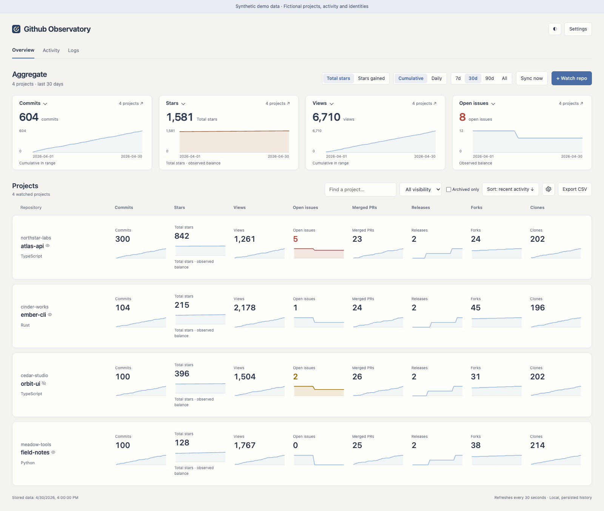
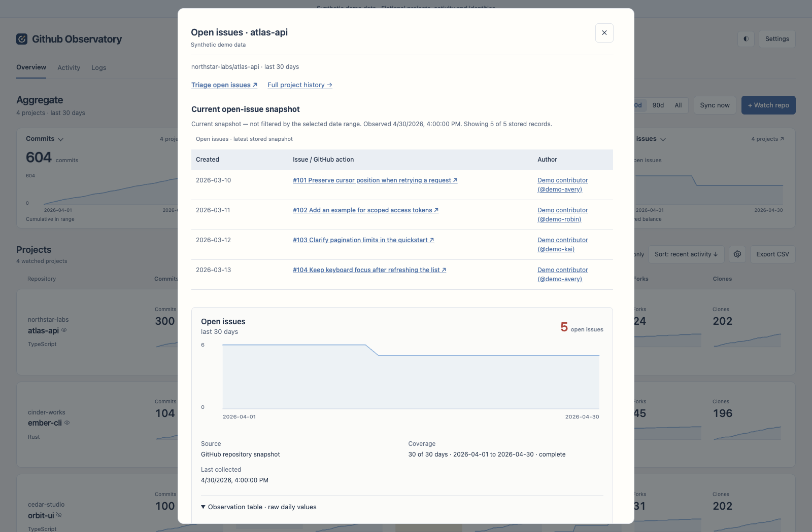
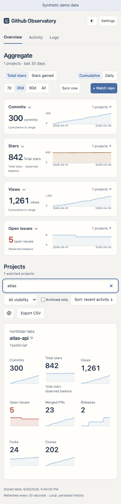

# Github Observatory

A self-hosted dashboard for the GitHub projects you care about.

See which projects are active, follow commits and releases, and find issues that need attention. Track stars, forks, and traffic over time, then click through to the people and changes behind the numbers.

Public repositories and the private ones you choose live in one place. You pick what to watch and which graphs to show; Observatory keeps the collected history on your server, even after it disappears from GitHub's short traffic window.

Your data stays on your server. There is no telemetry, hosted analytics account, or demo-data fallback in the application. Publishing this source does **not** publish your dashboard or database.

## A look inside

**Every project, count, and activity item in these screenshots is synthetic.** The isolated screenshot generator never reads a real database or account.





<details><summary>Mobile layout</summary>



</details>

## Run locally

Requires Node.js 24 or later. Runtime uses Node's built-in HTTP and SQLite modules; there are no third-party runtime dependencies.

```sh
npm ci
npm start
```

In another terminal in the project:

```sh
npm run open
```

The default server listens only on `127.0.0.1:47831`. The opener reads an owner-only local unlock file, opens your browser, and immediately removes the temporary handoff fragment from the address bar. The resulting session uses an HttpOnly, SameSite=Strict cookie. The unlock key is never printed or stored in browser localStorage.

To use a GitHub fine-grained token, create a file **outside this checkout**, readable only by its owner. Do not paste credentials into the dashboard, command history, or a GitHub issue. Configure its path:

```sh
export GITHUB_TOKEN_FILE=/absolute/path/to/owner-only-token-file
npm start
```

The token is optional for public watches and stays server-side. The app never reads GitHub CLI credentials or requests additional permissions. Settings lists owned repositories available to the configured token; private repositories are added only through explicit selection. Token-mode failures never fall back to anonymous requests.

### Configuration

| Variable | Default | Purpose |
|---|---|---|
| `OBSERVATORY_PORT` | `47831` (`8080` in the image) | Listening port |
| `OBSERVATORY_DATA_DIR` | `~/.local/share/github-observatory` (`/data` in the image) | Private SQLite and runtime state; outside source |
| `GITHUB_TOKEN_FILE` | unset | Owner-only scoped token file |
| `OBSERVATORY_BIND_HOST` | `127.0.0.1` | Set `0.0.0.0` only with the secured proxy configuration below |
| `OBSERVATORY_PUBLIC_ORIGIN` | unset | Exact HTTPS origin, without a trailing slash |
| `OBSERVATORY_PROXY_KEY_FILE` | unset | Owner-only random key shared with the authenticated reverse proxy |

Use the same data directory when starting and opening a local instance. For Docker/Unraid, follow the [deployment and backup guide](docs/deployment.md); do not simply expose the local port.

## Drill down, then act

- Click any overview card, count, or chart to see its repository contributions and daily observation table.
- Click a repository metric or sparkline to open its data modal. Commit, merged-PR, release, and current open-issue records link to the corresponding GitHub objects when collected.
- Open-issue records describe the latest complete **current snapshot**, not the historic state at the selected chart date. Collection failures retain the prior snapshot and remain visible.
- Metrics without individual records show actual observations plus appropriate GitHub destinations: stargazers, forks, traffic, and repository activity. Counts are never turned into invented records.
- Tables preserve raw daily values even in Cumulative mode. Unknown is not zero. Pagination, incomplete coverage, and stale observations are explicitly identified.
- Repository names still open a full history view. Modals support keyboard access, Escape, focus restoration, and mobile scrolling.
- Repository rows default to **recent activity**, with a remembered name/activity choice in Settings. The small cog above the rows opens **Repository graphs** directly; row metric choices are independent of the four top cards. **Show graph labels** repeats metric names throughout long lists and can be toggled in Settings.
- An eye beside each project name identifies a public repository; a crossed-out eye identifies a private one. Hover for the label. Archived status remains separate.
- **Unwatch** is available in Settings and the repository detail view, keeping overview rows uncluttered. It stops collection and removes the repository from active views while retaining history; adding the same repository again resumes it. Technical collection diagnostics are under **Logs**.

## Activity that explains what happened

Activity preserves real commit titles, author names/logins, timestamps, and useful context such as branch, PR number, merge refs, or release tag. Commit hashes are secondary identifiers, not the headline. Descriptive text is bounded and rendered as text; source code, diffs, email fields and raw provider responses are not collected.

The repository Events API adds observed stars and forks with actor profile links, pushes, issue activity, reviews, comments, ref changes, and other event types. Push events are distinct from individual commits: a push actor is not necessarily a commit author, and missing counts are not invented. Paginated activity and named star/fork details expose retained records, not people inferred from aggregate counters.

**This is not an exhaustive GitHub audit log.** GitHub's [Events API limits](https://docs.github.com/en/rest/activity/events) are up to **300 events from the past 30 days**, with **30 seconds–6 hours** of delay. Permission failures, collection budgets and gaps between polls can reduce coverage further. Once collected, records are retained locally. Historic surviving stargazers/forks are not silently treated as complete event history, and collection does not request broader permissions.

Repository activity is stored separately from metric observations, so adding feed events cannot inflate commit counts or erase existing chart history. Duplicate merge/release records are reconciled with authoritative endpoint records. Old databases upgrade without deleting observations; legacy commit titles become available after a successful refresh, rather than being guessed from a hash.

## Data, not demo numbers

- Current stars/forks are observed balances, not reconstructed history. Stars defaults to **Total stars**, plotting recorded balances. A remembered **Total stars / Stars gained** control switches every Stars graph; gains can be daily or cumulative and do not subtract unstarring. The headline is explicitly labeled Total stars in either view. Total-star aggregates use every headline contributor and leave dates with missing balances unknown; differing latest observation dates are identified as not comparable. A narrower gains cohort is disclosed separately.
- Four cards default to **Commits, Stars, Views, Open issues**. Settings and on-card selectors persist your choices in the browser. Selected unavailable metrics remain visible as grey placeholders in cards and repository rows, with an explanation instead of an invented zero. **Disabled on repo** requires a verified repository setting; missing access, collection failures and observations not yet collected are distinguished.
- Open-issue counts turn yellow strictly above **1**, red strictly above **3**. Thresholds are configurable; pull requests are excluded from issue counts.
- Graphs default to **Cumulative**. Event totals accumulate within the selected range; balances are never summed again. The Daily toggle is remembered. Tables and CSV retain raw values.
- Empty graphs show a full-width zero baseline as a visual reference, not a claim that missing observations were zero. Missing days in a populated series remain gaps. An initial balance observation is one point, not an invented flat history. Older retained balances keep their collection timestamp even outside a shorter chart window.
- Partial history does not support an unqualified growth comparison. Diagnostics retain permission, pagination, and rate-limit failures without replacing good data with zeros.
- Daily traffic totals can be summed; daily unique visitors are not summed and called unique people.
- Public and authenticated budgets are separate and persisted. Deferred repositories and metric families rotate across cycles.
- Collection runs hourly inside the app process. No separate operating-system or cloud scheduler is required.

## Security boundaries

All data-bearing APIs require a session. Mutations require an exact same-origin request and CSRF token. Host validation protects against DNS rebinding. Responses are non-cacheable, assets self-hosted, and repository text is untrusted content.

Remote mode additionally requires an authenticated HTTPS reverse proxy to **overwrite** `X-Observatory-Proxy-Key` with a random secret. Every external request must carry the correct key and configured host. The browser never receives that key; the proxy's login grants the app session without a second unlock prompt. Cookies are Secure in remote mode. Forwarded headers alone grant no trust. Only a generic, loopback-only health probe bypasses the proxy gate.

The reverse proxy is the remote identity boundary: protect **all paths**, including custom locations. Anyone admitted by its access policy can use this single-user application. Keep the backend private; do not publish the key or rely on a client-supplied header. This is not a multi-tenant authorization system.

A malicious process running as the app's operating-system user can read its secrets and database. Keep state and backups private. Never commit real screenshots, logs, backups, or account fixtures. The privacy preflight permits only the three reviewed synthetic documentation images; it is a heuristic, not a substitute for reviewing the exact publication artifact.

## Development

```sh
npm ci
npx playwright install chromium
npm test
npm run check
node scripts/screenshots.mjs
```

Playwright is dev-only. Set `PLAYWRIGHT_CHROMIUM_EXECUTABLE` to an existing Chrome-compatible browser when needed. Tests and the reproducible screenshot harness use synthetic fixtures and no production credentials. See the [API contract](docs/api-contract.md) and [deployment guide](docs/deployment.md).
